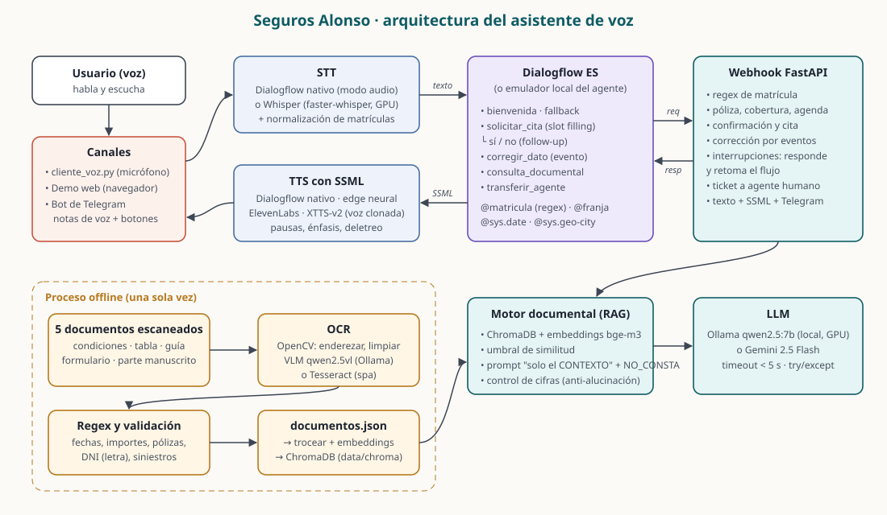

# Seguros Alonso · Clara, asistente de voz

Evaluación final de **Herramientas de IA Clásica** (Máster en IA, Cloud Computing y DevOps).
https://github.com/manupm87/pontia-modulo-ia-clasica/

## El caso de uso

**Seguros Alonso** es una aseguradora de coches ficticia. Su asistente telefónico, **Clara**, atiende por voz
a los clientes que han tenido un golpe y necesitan que **un perito revise el coche**: identifica la póliza
por la matrícula (validada con expresión regular), recoge el día, la franja y la ciudad, comprueba que la
modalidad cubre el daño, que el día es laborable y que hay taller concertado, resume y pide confirmación,
y crea la cita con perito, hora y dirección. Además responde dudas sobre **cinco documentos escaneados**
(condiciones generales, tabla de coberturas y precios, guía de peritaje y asistencia, condiciones particulares
de una póliza y un parte de siniestro **manuscrito**) que se procesaron offline con OCR. Si lo que se pregunta
no está en los documentos, lo dice en lugar de inventarlo. Se puede interrumpir el flujo con una pregunta,
corregir un dato a mitad ("mejor por la tarde") o pedir hablar con una persona.

## Vídeo de la demo

Conversación completa por voz contra el **Dialogflow ES real**, con su reconocimiento y su síntesis de voz nativos
(2 min 23 s): cita de peritaje con contexto, interrupción, corrección a mitad de flujo, confirmación, preguntas
respondidas con los documentos, una pregunta sin respuesta en ellos y paso a una persona. La voz del cliente es
sintética; Google la reconoce como si fuera un micrófono.

https://github.com/user-attachments/assets/6570c0aa-fc76-495e-907b-b1235b2ddedf

Fichero en el repositorio: [`demo/salida_google/demo.mp4`](demo/salida_google/demo.mp4) · informe de latencias por
turno: [`demo/salida_google/informe.md`](demo/salida_google/informe.md).

## Arquitectura



| Pieza | Dónde | Qué hace |
| --- | --- | --- |
| Agente Dialogflow ES | `agente_dialogflow/` → `dist/SegurosAlonso.zip` | Intenciones, entidades, contexto y follow-ups |
| Webhook FastAPI | `webhook/` | Lógica de negocio, regex, eventos, interrupciones, RAG, SSML, Telegram |
| OCR offline | `ocr/` | Genera/lee los documentos, preprocesa, OCR, regex, índice vectorial |
| Voz | `voz/`, `cliente_voz.py` | STT (Dialogflow nativo o Whisper), TTS con SSML (nativo, edge, ElevenLabs, XTTS clonada) |
| Emulador de Dialogflow | `dialogflow_local/` | Ejecuta el mismo export del agente en local para probar sin cuenta de Google |
| Telegram | `telegram_bot.py` | Texto, notas de voz y botones |
| Demo | `demo/` | Página web con micrófono y panel interno, demo guiada que genera vídeo |

## Intenciones

Mapa: un único flujo con un único contexto propio, `ctx_solicitud_en_curso`, que abren `solicitar_cita` y cierra
la confirmación. `solicitar_cita-followup` no es un segundo flujo: es el contexto que Dialogflow crea automáticamente
para las intenciones de seguimiento sí/no, y solo vive los dos turnos de la confirmación.

**Recuento.** Las 6 intenciones significativas son `solicitar_cita`, sus dos seguimientos `- si` y `- no`,
`consulta_documental`, `corregir_dato` y `transferir_agente` (además de bienvenida y fallback). Las cuatro primeras
cubren el mínimo del enunciado (petición del servicio, recogida de datos, confirmación sí/no y consulta documental);
`corregir_dato` y `transferir_agente` son las de las mejoras opcionales.

| Intención | Contexto entrada → salida | Propósito |
| --- | --- | --- |
| `Default Welcome Intent` | – | Saludo de Clara (evento `WELCOME`), con botones en Telegram |
| `solicitar_cita` | – → `ctx_solicitud_en_curso`, `solicitar_cita-followup` | Abre el flujo y recoge **matrícula**, **fecha**, **franja** y **ciudad** (obligatorias) y el tipo de daño (opcional). Webhook en cada turno de *slot filling*. Evento `SOLICITAR_CITA` para reentrar con datos corregidos |
| `solicitar_cita - si` | follow-up → cierra contextos | Confirmación: el webhook revalida y crea la cita |
| `solicitar_cita - no` | follow-up → `ctx_solicitud_en_curso` (3) | No confirma: deja corregir un dato o la solicitud queda cancelada |
| `corregir_dato` | `ctx_solicitud_en_curso` | **Extra**: corrección a mitad de flujo ("mejor el jueves", "la matrícula es 5678 FGH"). El webhook fusiona el dato y relanza `SOLICITAR_CITA` |
| `consulta_documental` | – (retoma el flujo si estaba abierto) | Preguntas sobre los documentos → RAG con control de alucinaciones |
| `transferir_agente` | – → cierra contextos | **Extra**: transferencia a agente humano con ticket y resumen de lo recogido |
| `Default Fallback Intent` | – | Antes de rendirse intenta responder con los documentos |

Entidades: `@matricula` (**regex** `[0-9]{4}\s?[B-DF-HJ-NP-TV-Z]{3}`), `@franja` y `@tipo_dano` (propias, con
sinónimos), `@sys.date` y `@sys.geo-city` (sistema).

## Resultados medidos

**OCR** (qwen2.5vl:7b, 4-9 s por página, una sola vez):

| Documento | Tipo | CER | Palabras encontradas | Campos validados con regex |
| --- | --- | --- | --- | --- |
| 01 condiciones generales | texto corrido | 2,5 % | 97,9 % | teléfonos, importes |
| 02 tabla de coberturas | tabla con rejilla | 0,5 % | 100 % | primas anuales (285; 398,50; 589; 845,90 €) |
| 03 guía de peritaje | folleto a 2 columnas | 0,5 % | 98,6 % | teléfonos, póliza, código de cita |
| 04 condiciones particulares | formulario + manuscrito | 10,2 % | 95,1 % | DNI 12345678Z (letra verificada), matrícula, póliza, 5 fechas, prima 612,40 € |
| 05 parte de siniestro | manuscrito + sello | 32,8 % | 84,9 % | SIN-2026-004512, fechas, matrícula, póliza, teléfono |

El CER alto de los formularios se debe sobre todo al orden: el VLM reorganiza los formularios como tablas
o listas y omite cabecera y pie. El manuscrito se lee bien palabra a palabra, como muestra la columna de
palabras encontradas.

**Recuperación.** 42 fragmentos (~380 caracteres) con embeddings **bge-m3** en ChromaDB (coseno). Cada fila de la
tabla es un fragmento autodescriptivo ("Granizo · Terceros básico: ✗ · …"), y cada documento añade un fragmento con
sus campos validados. Umbral de similitud **0,40**, calibrado con 22 preguntas con respuesta y 14 sin respuesta:
corta sin gastar LLM las que no tienen nada que ver (0,30-0,38). Las preguntas del dominio sin respuesta en los
documentos (moto, vida, hogar: 0,52-0,63) se solapan con las que sí la tienen, y las paran el `NO_CONSTA` y las
comprobaciones de evidencia y cifras. Las 36 preguntas de calibración salen bien; respuesta media 0,30 s.

**Voz y latencia** (demo guiada, 11 turnos, TTS sin caché, RTX 5090):

| Etapa | Tiempo típico |
| --- | --- |
| STT Whisper `small` en GPU (3 s de audio) | 0,07-0,15 s |
| Dialogflow (emulador) + webhook | < 0,01 s; con consulta documental 0,2-0,4 s |
| TTS neuronal con SSML (2 frases) | 0,7-1,4 s |
| **Turno completo** | **media 1,29 s · máximo 2,45 s** (objetivo < 5 s) |

**Con Dialogflow ES real y su voz nativa** (`DIALOGFLOW_BACKEND=google python -m demo.demo_guiada --salida demo/salida_google`):
los 11 turnos van a la intención correcta con el STT y el TTS de Google en modo audio, **media 1,66 s y máximo 2,05 s
por turno** (incluye STT, webhook con RAG y TTS). El TTS nativo interpreta el SSML: no lee las etiquetas y deletrea el
código de la cita. Vídeo: [más arriba](#vídeo-de-la-demo).
La versión 100 % local (emulador + Whisper + TTS neuronal) está en `demo/salida/`.

**Matrículas por voz.** El STT de Google, sin ayuda, transcribía "1234 BCD" como "1234" y se perdían las letras.
Tres medidas lo resuelven: pistas de adaptación del STT (`speech_contexts` con los nombres de las consonantes: be, ce,
de…), medio segundo de silencio al final del audio (sin él se cortaba la última letra) y, en el webhook, una
normalización del texto reconocido ("1234 be ce de", "1.234 BCD", "cinco seis siete ocho efe ge hache" → "1234 BCD",
"5678 FGH") que rescata la matrícula cuando la entidad regex no la reconoce y la reinyecta con el evento
`SOLICITAR_CITA`. Efecto secundario conocido: con las pistas de letras, "vida" se reconoció como "be de", por eso la
pregunta sin respuesta del guion es ahora "¿tenéis también seguro de moto?".

**Respuestas sueltas mal clasificadas.** Tras una interrupción, Dialogflow mandó alguna vez "el lunes por la mañana"
al fallback en lugar de a `corregir_dato`. Además de añadir respuestas sueltas a sus frases de entrenamiento, el
fallback hace de red de seguridad: si hay una cita a medias y la frase no es una pregunta, extrae fecha, franja y
ciudad con el mismo extractor de entidades en español del emulador y sigue el flujo con el evento `SOLICITAR_CITA`.


**Tests:** 123 pruebas con pytest (negocio, webhook, emulador, regex del OCR, RAG contra Ollama, voz, Telegram).


## Decisiones técnicas

**Validación en el webhook, no solo en Dialogflow.** La entidad regex hace que Dialogflow reconozca la
matrícula, pero el webhook vuelve a aplicar la regex tras normalizar (`1234-bcd` → `1234BCD`), busca la póliza y
aplica las reglas del negocio: la modalidad *terceros ampliado* solo permite peritaje por lunas, no hay peritos
en fin de semana, máximo 30 días de antelación y solo ciudades con taller concertado. Cada error se explica
y se pregunta solo por el dato erróneo, sin empezar de cero. Si hay un error se cierra el follow-up para que un
"sí" no confirme una cita inválida, y en la confirmación se revalida todo antes de crear la cita.

**Corrección de datos mediante eventos.** `corregir_dato` solo se activa con el contexto del flujo abierto.
El webhook fusiona el dato nuevo con los parámetros guardados en el contexto y responde con
`followupEventInput: SOLICITAR_CITA`. Los parámetros de `solicitar_cita` tienen como valor por defecto
`#SOLICITAR_CITA.<parametro>`, así que la intención se rellena sola, el webhook revalida y se vuelve a pedir
confirmación con el resumen actualizado.

**Interrupciones.** Comprobado en la consola de Dialogflow: si a mitad de la recogida de datos el usuario
pregunta algo que encaja con otra intención ("¿tengo que pagar algo por el peritaje?"), Dialogflow ES **abandona el
slot filling** y con él sus contextos internos. Por eso el webhook, en cada turno de *slot filling*, guarda lo recogido
en `ctx_solicitud_en_curso`. `consulta_documental` responde y, al ver ese contexto, retoma: "Seguimos con tu cita. ¿Qué día
te viene bien?". La respuesta ("el lunes por la mañana") entra por `corregir_dato`, que relanza el evento
`SOLICITAR_CITA` con todo lo guardado; y si Dialogflow volviera a entrar en `solicitar_cita` desde cero, el webhook
detecta los datos del contexto y relanza el mismo evento. En la fase de confirmación funciona igual: responde, vuelve a
leer el resumen y renueva los contextos.

**Copia de seguridad en el contexto.** Otro comportamiento real de Dialogflow: los contextos de salida de una intención
reciben **todos** sus parámetros, también los vacíos, así que al activarse `corregir_dato` con solo la fecha, la
matrícula del contexto pasa a `""`. El webhook guarda cada dato también como `guardado_<parametro>`, una clave que
ninguna intención escribe, y la usa cuando el valor normal llega vacío. El emulador local reproduce este
comportamiento para que los tests lo cubran.

**Voz natural con SSML.** El cliente de voz manda `{"canal": "voz"}` en el payload. Para ese canal el
`fulfillmentText` es SSML (`<speak>`): pausas entre ideas, matrículas y códigos de cita deletreados
(`<say-as interpret-as="characters">`), énfasis en la pregunta de confirmación y la lista de documentos más lenta.
Para Telegram y chat se manda texto plano. Las respuestas son cortas (2-3 frases) porque se van a escuchar.

**OCR con modelo de visión y preprocesado.** El enunciado admite Tesseract, Azure o un VLM vía Ollama. El motor por
defecto es **qwen2.5vl:7b** en Ollama (local, GPU), porque los documentos son "complejos" a propósito: una tabla
con rejilla y ✓/✗, un folleto a dos columnas, un formulario con campos manuscritos y casillas, y un parte de
siniestro escrito a mano con sello. El VLM devuelve Markdown y conserva las tablas como tablas. Tesseract está
soportado (`--motor tesseract`, se detecta solo; modo de segmentación por documento) para comparar.
Preprocesado con OpenCV antes del OCR, cada paso con su porqué en `ocr/ocr.py`: escala de grises,
**enderezado** (estimación del ángulo con Hough y respaldo con `minAreaRect`; las páginas venían giradas 0,5-2°),
**eliminación de ruido** Non-Local Means (las motas se leen como comas y tildes) y **CLAHE** (iluminación
irregular y tinta azul débil). Solo para Tesseract se amplía ×1,5 y se binariza con umbral adaptativo; al VLM no se
le binariza porque rompe los trazos finos del manuscrito.
**Errores de OCR.** Las regex se aplican primero sobre el texto tal cual. Después, unos patrones "laxos" buscan
candidatos con las confusiones típicas (O/0, l/1, S/5, B/8) y se corrigen **solo esos tokens**, nunca el texto
entero que va al LLM; la corrección se acepta únicamente si el valor resultante pasa la validación (fecha real
de calendario, letra de control del DNI, formato de póliza/matrícula/siniestro) y queda registrada como aviso.
La calidad se mide con CER/WER contra el texto real de cada documento (`documentos/ground_truth.json`).

**Por qué no la Knowledge Base de Dialogflow.** Es una función beta que solo acepta FAQ o artículos en texto
(no imágenes), no deja controlar el prompt ni decir "no lo sé" de forma fiable, y no permite validar los campos
con regex. Con el RAG propio controlamos la recuperación, el umbral, el prompt y las comprobaciones.

**Control de alucinaciones en capas.** (1) Si ningún fragmento supera el umbral de similitud, se responde que
no consta sin llamar al LLM. (2) El prompt obliga a usar solo el CONTEXTO y a contestar `NO_CONSTA` si no está.
(3) Si la respuesta contiene cifras o importes que no aparecen en los fragmentos recuperados, se descarta.
En todos los casos el mensaje es explícito: "No dispongo de esa información en la documentación… ¿Quieres que
te pase con un agente?".

Una revisión independiente encontró dos alucinaciones que esas capas no paraban, y ya están corregidas con test:
- **Tarifa general en vez de la póliza.** "¿Cuánto cuesta el todo riesgo para el Seat León de Ana?" daba 589 € (tarifa
  de catálogo, que sí está en los documentos y por eso pasaba el control de cifras) en vez de los 612,40 € de su póliza.
  Si la pregunta habla de una póliza concreta (nombre, "mi póliza", su coche o matrícula), el contexto lleva sus
  condiciones particulares y no la tabla general de precios.
- **Datos del cliente deducidos.** A "¿cubre a mi hijo de 18 años?" el modelo añadía que "carece de permiso de
  conducir", algo que no dice ningún documento. El prompt prohíbe ahora deducir datos del cliente que no estén escritos.

**Si el modelo tarda o falla.** Dialogflow corta el webhook a los 5 s. El OCR va offline y el índice se carga al
arrancar, el LLM se precalienta, la llamada tiene timeout (3,5 s) y `try/except`, y el manejador entero está
protegido: ante cualquier error se responde algo útil ("he tenido un problema técnico, ¿te paso con un agente?").

**Emulador local de Dialogflow.** Para probar todo sin cuenta de Google Cloud y escribir tests de extremo a
extremo, `dialogflow_local/` carga el mismo export del agente y reproduce lo que usa este proyecto: coincidencia de
frases de entrenamiento, entidades regex/propias/fecha/ciudad, contextos con vida, *slot filling* con webhook,
follow-ups, eventos y `followupEventInput`, con la petición al webhook en el formato real de Dialogflow ES v2.
Con `DIALOGFLOW_BACKEND=google` todo funciona igual contra el agente real: el guion completo de la demo se ha probado en la consola de Dialogflow ES con el webhook expuesto por un túnel (todas las intenciones correctas, webhook en ≤ 0,6 s).

## Mejoras opcionales

Probadas de extremo a extremo:

| Mejora del enunciado | Cómo está resuelta | Evidencia |
| --- | --- | --- |
| Interrupciones y corrección a mitad de flujo con eventos | `corregir_dato` + `followupEventInput: SOLICITAR_CITA`; las preguntas en mitad de la recogida de datos o de la confirmación se responden y el flujo se retoma | Turnos 4 y 7 del vídeo, con Dialogflow real |
| Transferencia a agente humano | `transferir_agente`: ticket, resumen de lo recogido, `liveAgentHandoff` en el payload y teléfono de atención | Turno 11 del vídeo |
| Base de datos vectorial | ChromaDB + embeddings bge-m3 (Ollama), con recuperación por palabras como respaldo | Turnos 4, 9 y 10; `tests/test_rag.py` |
| Documentos complejos | Tabla con rejilla, folleto a 2 columnas, formulario con campos manuscritos y casillas, parte de siniestro manuscrito con sello. Los documentos son **sintéticos** (generados con `ocr/generar_documentos.py` y "escaneados" con giro, ruido, desenfoque y JPEG) para conocer su texto real y medir el OCR | CER/WER por documento en *Resultados medidos* |
| STT/TTS de terceros | Whisper (faster-whisper en GPU) y TTS neuronal edge con SSML (se trocea en segmentos con su velocidad y tono, y las pausas se insertan como silencio) | Vídeo local `demo/salida/demo.mp4` y demo web |

Implementadas pero **no probadas con el servicio real** (falta la cuenta o la muestra de voz):

| Mejora | Estado |
| --- | --- |
| Telegram con respuestas enriquecidas | `telegram_bot.py`: texto, notas de voz (Whisper → Dialogflow → nota de voz) y botones *inline*; el webhook emite además el payload `TELEGRAM` para la integración nativa. Probado con un cliente de Dialogflow simulado (`tests/test_telegram.py`), no con un bot real: hace falta `TELEGRAM_BOT_TOKEN` |
| ElevenLabs y clonación instantánea | Backend completo contra la API REST (`voz/tts.py`, `voz/clonar_voz.py elevenlabs`). Sin probar: hace falta `ELEVENLABS_API_KEY` |
| Clonación de voz propia con XTTS-v2 | Entorno `.venv-xtts` instalado y servidor `voz/xtts_servidor.py`. **No hecha** con la voz del autor: falta grabar `voz/muestras/referencia.wav` (`python -m voz.clonar_voz grabar`) y aceptar la licencia no comercial CPML de Coqui en la primera descarga del modelo. La única muestra incluida, `referencia_demo.wav`, es una voz sintética |

Además: emulador local de Dialogflow ES para probar sin nube, demo web con panel interno (intención, parámetros,
contextos, SSML, latencias) y demo guiada que genera el vídeo.


## Cómo ejecutarlo

### 1. Entorno

```bash
uv venv --python 3.11 .venv
```

```bash
uv pip install --python .venv/Scripts/python.exe -r requirements.txt
```

```bash
copy .env.example .env
```

Modelos locales (LLM, embeddings y visión para el OCR):

```bash
ollama pull qwen2.5:7b
```

```bash
ollama pull bge-m3
```

```bash
ollama pull qwen2.5vl:7b
```

### 2. OCR offline (una sola vez)

```bash
.venv\Scripts\python -m ocr.generar_documentos
```

```bash
.venv\Scripts\python -m ocr.ocr --motor auto
```

```bash
.venv\Scripts\python -m ocr.indexar
```

El índice vectorial (`data/chroma/`) no se versiona porque cambia en cada ejecución: si no existe, el webhook lo
construye solo al arrancar a partir de `data/documentos.json` (unos segundos con Ollama).

### 3. Webhook

```bash
.venv\Scripts\uvicorn webhook.main:app --port 8000
```

Para Dialogflow real hay que exponerlo a internet (VS Code → PORTS → Public, `devtunnel host -p 8000` o, sin cuenta, `cloudflared tunnel --url http://127.0.0.1:8000`) y
poner la URL terminada en `/webhook` en **Fulfillment**. Comprobación: abrir la URL raíz debe devolver
`{"estado": "ok", ...}`.

### 4. Agente de Dialogflow

```bash
.venv\Scripts\python scripts\empaquetar_agente.py
```

En la consola de Dialogflow ES: ⚙️ → *Export and Import* → **Restore from ZIP** con `dist/SegurosAlonso.zip`.
Después: cambiar la URL de Fulfillment y pulsar **Train**. El proceso completo, con credenciales y túnel, está en
[Puesta en marcha con Dialogflow real](#puesta-en-marcha-con-dialogflow-real).

### 5. Hablar con Clara

Demo web con micrófono, panel interno y demo guiada (`http://localhost:8080`):

```bash
.venv\Scripts\uvicorn demo.servidor:app --port 8080
```

Cliente de voz por terminal (Enter para hablar). Con Dialogflow real y su STT/TTS nativos:

```bash
.venv\Scripts\python cliente_voz.py --backend google --stt dialogflow --tts dialogflow
```

Todo en local (emulador + Whisper + TTS neuronal):

```bash
.venv\Scripts\python cliente_voz.py --backend local --stt whisper --tts edge
```

Demo guiada que genera `demo/salida/demo.mp4`, el audio y un informe de latencias:

```bash
.venv\Scripts\python -m demo.demo_guiada
```

Bot de Telegram (con `TELEGRAM_BOT_TOKEN` en `.env`):

```bash
.venv\Scripts\python telegram_bot.py
```

### 6. Tests

```bash
.venv\Scripts\python -m pytest -q
```

En Linux o macOS los comandos son los mismos cambiando `.venv\Scripts\` por `.venv/bin/` (y `copy` por `cp`).

## Puesta en marcha con Dialogflow real

Estos son los pasos seguidos para probar el proyecto contra Dialogflow ES con su voz nativa. Todo lo anterior
funciona sin cuenta de Google (emulador local); esto es lo que hace falta además para el agente real.

### 1. Crear el agente e importar el export

1. En https://dialogflow.cloud.google.com → **Create Agent**: nombre `SegurosAlonso`, idioma **Spanish — es**, zona
   **Europe/Madrid** y **Create a new Google project** (o uno existente). Apunta el ID del proyecto (aquí
   `segurosalonso-al9y`).
2. ⚙️ → **Export and Import** → **Restore from ZIP** → `dist/SegurosAlonso.zip` → escribir `RESTORE`. *Restore* borra
   todo lo que hubiera en el agente.
3. Esperar a que termine el **entrenamiento** (un minuto, aproximadamente) antes de probar: si no, las frases caen en
   intenciones equivocadas o en el fallback.

### 2. Exponer el webhook

Con el webhook arrancado en el puerto 8000, abrir un túnel (no necesita cuenta):

```bash
cloudflared tunnel --url http://127.0.0.1:8000
```

En **Fulfillment** → *Webhook* activado, URL = la que imprime `cloudflared` + `/webhook`, y **Save**. La cabecera
`X-Tunnel-Skip-AntiPhishing-Page` ya viene en el export (la necesitan los devtunnels de VS Code; a cloudflared no le
afecta). Comprobación: la URL del túnel sin `/webhook` debe devolver `{"estado": "ok", ...}`.

Hay que volver a poner la URL en Fulfillment cada vez que:
- se reinicia `cloudflared`, porque cada ejecución da una URL nueva;
- se hace **Restore from ZIP**, porque el export lleva un marcador (`https://TU-TUNEL.devtunnels.ms/webhook`) para no
  publicar URLs reales, y la restauración lo vuelve a poner.

### 3. Credenciales para la voz nativa (cuenta de servicio)

Con el [SDK de Google Cloud](https://cloud.google.com/sdk/docs/install) instalado (en Windows,
`winget install Google.CloudSDK`) y sustituyendo `segurosalonso-al9y` por tu proyecto:

```bash
gcloud auth login
```

```bash
gcloud services enable dialogflow.googleapis.com iam.googleapis.com --project segurosalonso-al9y
```

```bash
gcloud iam service-accounts create clara-dialogflow --project segurosalonso-al9y --display-name=Clara-Dialogflow
```

```bash
gcloud projects add-iam-policy-binding segurosalonso-al9y --member serviceAccount:clara-dialogflow@segurosalonso-al9y.iam.gserviceaccount.com --role roles/dialogflow.client --condition=None
```

```bash
gcloud iam service-accounts keys create %USERPROFILE%\.secrets\segurosalonso-dialogflow.json --iam-account clara-dialogflow@segurosalonso-al9y.iam.gserviceaccount.com
```

La clave se guarda **fuera del repositorio**; aun así, el `.gitignore` ignora `*clave*.json` y `credenciales*.json`.
En Windows, `--display-name` no debe llevar espacios, porque `gcloud.cmd` parte mal el argumento. Después, en `.env`:

```
DIALOGFLOW_BACKEND=google
DIALOGFLOW_PROJECT_ID=segurosalonso-al9y
GOOGLE_APPLICATION_CREDENTIALS=C:\Users\<usuario>\.secrets\segurosalonso-dialogflow.json
```

Con `DIALOGFLOW_BACKEND=local` todo vuelve al emulador sin tocar nada más.

### 4. Probar

Por texto, en el simulador de la consola (panel derecho, *Try it now*), con el guion de `demo/guion.py`. Si algo
falla, **Diagnostic info** muestra la intención, los parámetros y la respuesta del webhook.

Por voz, con el STT y el TTS nativos de Dialogflow:

```bash
.venv\Scripts\python cliente_voz.py --backend google --stt dialogflow --tts dialogflow
```

Las matrículas se dictan cifra a cifra y letra a letra ("uno dos tres cuatro, be ce de"); el webhook las reconstruye
aunque el STT las transcriba de otra forma.

Vídeo de la demo con el agente real (el cliente habla con voz sintética; la salida va a `demo/salida_google/`).
Con `DIALOGFLOW_BACKEND=google` en `.env`, la demo usa el modo audio nativo de Dialogflow:

```bash
.venv\Scripts\python -m demo.demo_guiada --salida demo/salida_google
```

### 5. Cuando cambias algo

| Cambias… | Qué hacer después |
| --- | --- |
| El código del webhook (`webhook/`) | Reiniciar uvicorn, que se arranca sin `--reload`. Con `cloudflared` corriendo aparte, la URL del túnel no cambia |
| El agente (`agente_dialogflow/`) | `python scripts\empaquetar_agente.py` → **Restore from ZIP** → volver a poner la URL en Fulfillment → esperar al entrenamiento |
| Los documentos | `python -m ocr.ocr`, después borrar `data/chroma/` (o ejecutar `python -m ocr.indexar`) y reiniciar el webhook |
| La URL del túnel | Solo Fulfillment → URL → **Save** |

Para que el emulador local y el agente real no se separen, los cambios del agente se hacen siempre en
`agente_dialogflow/` y se importan, no editando en la consola. Si se edita en la consola, hay que exportar el ZIP y
copiar su contenido a `agente_dialogflow/`.
